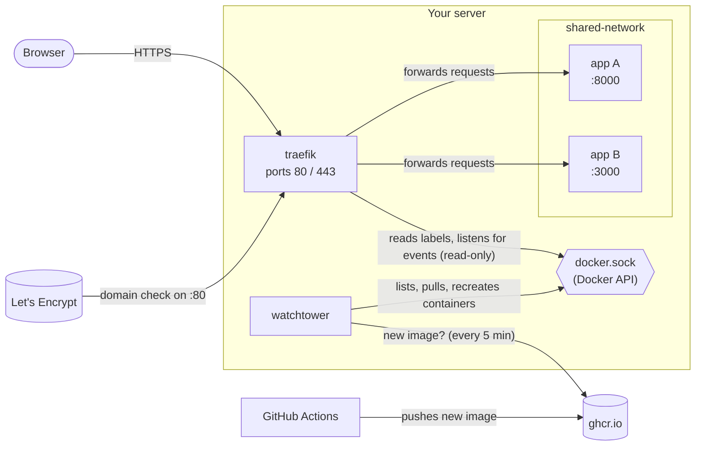
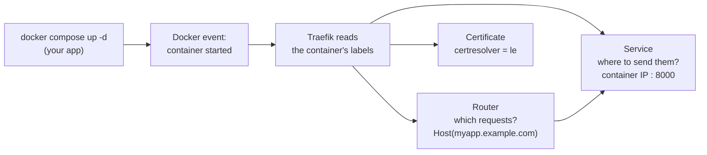
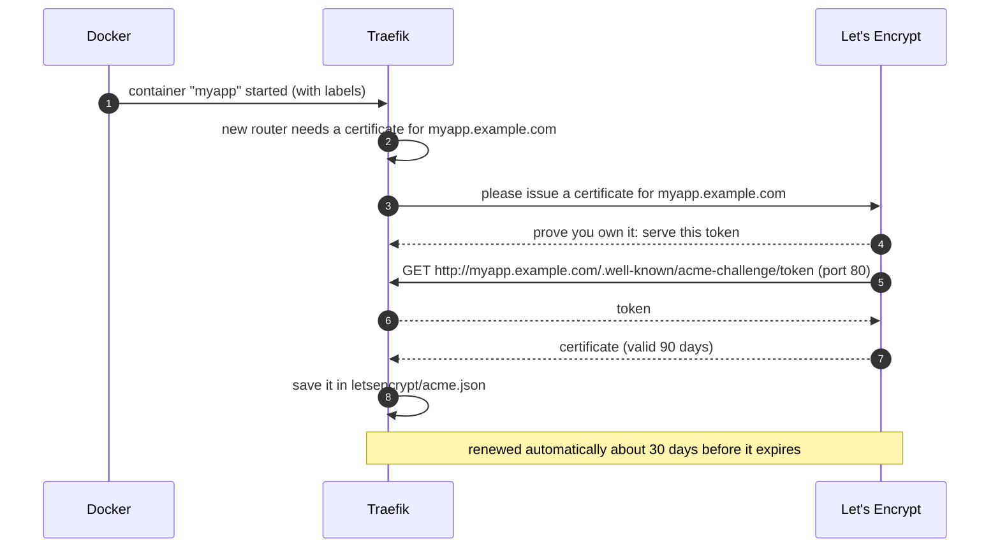
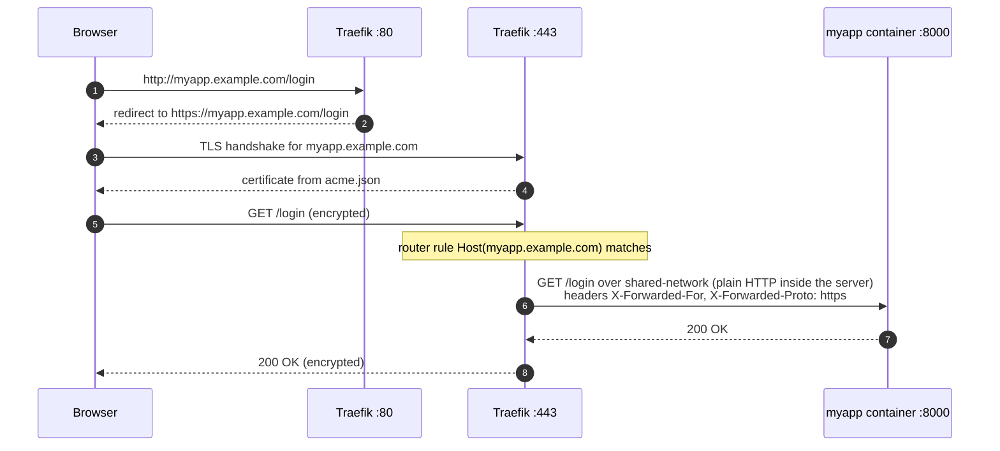
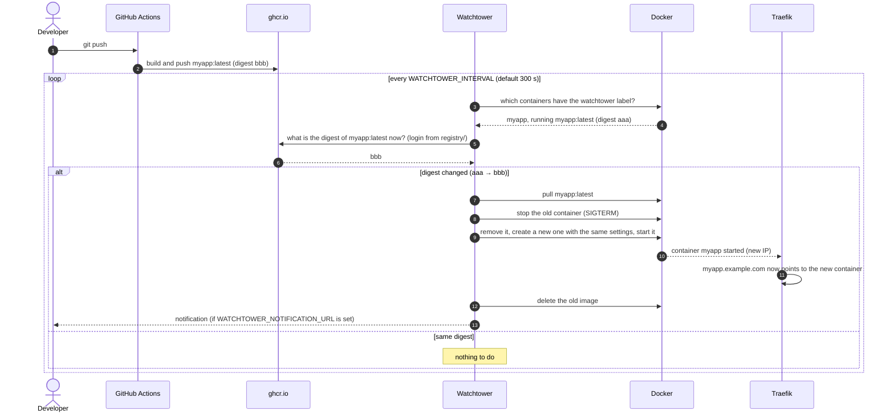

# dockeredge

**One Traefik and one Watchtower per server, shared by every Docker Compose app on it.**

You install dockeredge once. After that, every app you run on the server, from any repo
or GitHub account, gets:

- **HTTPS on its own domain.** Traefik issues and renews Let's Encrypt certificates.
- **Auto-deploy.** Watchtower pulls the new image and restarts the app after every push.

An app opts in with a few labels in its own `docker-compose.yml`. There's no nginx
config to write and no proxy per project.

```
                Internet  :80 / :443
                        │
        ┌───────────────▼────────────────┐
        │ dockeredge                     │
        │   traefik    → HTTPS + routing │
        │   watchtower → auto-deploy     │
        └───────┬────────────────┬───────┘
                │ shared-network │
          ┌─────▼─────┐    ┌─────▼─────┐
          │  app A    │    │  app B    │   any repo, any account,
          │  + its db │    │  + redis  │   each with its own compose
          └───────────┘    └───────────┘
```

To see what happens inside, with diagrams, read [How it works](#how-it-works).

---

## 1. Install

**You need:** a Linux server with Docker (Compose v2), ports **80** and **443** open,
and your domains' DNS `A` records pointing at the server.

```bash
git clone https://github.com/Tohirbek04/dockeredge.git
cd dockeredge
./setup.sh
```

`setup.sh` asks for two things:

1. **An email** for Let's Encrypt (required).
2. **A GitHub token** for private images (optional, press Enter to skip). See [Private images](#4-private-images).

Everything else happens automatically: Docker, ports and name clashes are checked,
the shared network, `.env` and certificate storage are created, and the stack starts.
You can re-run `./setup.sh` at any time.

Non-interactive: `GHCR_TOKEN=ghp_… ./setup.sh --email you@example.com`

---

## 2. Connect your app

Add **the network** and **the labels** to your app's `docker-compose.yml`:

```yaml
services:
  app:
    image: ghcr.io/you/myapp:latest
    pull_policy: always
    networks: [default, shared-network]
    labels:
      # auto-deploy (remove if you build on the server, see section 3)
      com.centurylinklabs.watchtower.enable: "true"
      # HTTPS on your domain
      traefik.enable: "true"
      traefik.http.routers.myapp.rule: "Host(`myapp.example.com`)"
      traefik.http.routers.myapp.entrypoints: "websecure"
      traefik.http.routers.myapp.tls.certresolver: "le"
      traefik.http.services.myapp.loadbalancer.server.port: "8000"   # port your app listens on
      traefik.docker.network: "shared-network"

networks:
  shared-network:
    external: true
```

Then `docker compose up -d` in the app's folder. Within a minute the app is live at
`https://myapp.example.com`.

**Four rules:**

1. Use a **unique name** instead of `myapp`, and a unique `container_name` and domain.
   Two apps with the same router name break each other.
2. **Don't publish ports** (`ports:`) in the app. Traefik owns 80/443, and the database
   stays private to the app.
3. **Start dockeredge first.** Apps need its `shared-network`.
4. The app can live in **any repo or GitHub account**. The server needs only its
   `docker-compose.yml` and `.env`, not the whole repo.

---

## 3. Deploying updates

Watchtower can only update images that come **from a registry**. Choose one way per app:

| Your app… | Deploy a new version by… |
|---|---|
| uses `image: ghcr.io/…` + the Watchtower label | `git push`, then CI builds and pushes the image, and Watchtower restarts the app **within 5 minutes** |
| uses `build: .` on the server (no Watchtower label) | `git pull && docker compose up -d --build` on the server |

Watchtower replaces the **image** only. Changes to the app's `docker-compose.yml` or `.env`
still need `docker compose up -d` on the server.

---

## 4. Private images

A single **classic GitHub token** with the `read:packages` scope reads every image your
account has access to: yours, your organizations', and images others shared with you.
You don't need one login per account.

**Create it:** GitHub → Settings → Developer settings → Tokens (classic) → tick
`read:packages` only.

**Enter it once.** Paste it when `setup.sh` asks, or put it in `.env`:

```bash
GHCR_TOKEN=ghp_xxxxxxxxxxxxxxxxxxxx
```

The username is detected from the token. `setup.sh` checks the token and logs in on every
run. To change the token, edit `.env` and re-run `./setup.sh`.

**Check access before deploying:**

```bash
./registry.sh check ghcr.io/you/app:latest ghcr.io/friend/api:latest
# ✔ ghcr.io/you/app:latest
# ✖ ghcr.io/friend/api:latest — no access …
```

**Image owned by someone else?** Ask them to give you access in one of two ways: add you
as a collaborator on the repo, or open Package settings → Manage access → add you with
**Read**.

> Fine-grained tokens can't read other accounts' packages, so use a **classic** token.
> When the token expires, Watchtower quietly stops updating. `./registry.sh check` shows it.

---

## 5. Options

### Settings (`.env`)

| Variable | Default | Meaning |
|---|---|---|
| `LETSENCRYPT_EMAIL` | — | **required** |
| `GHCR_TOKEN` | — | token for private images (section 4) |
| `WATCHTOWER_INTERVAL` | `300` | seconds between update checks |
| `WATCHTOWER_NOTIFICATION_URL` | — | update notifications, e.g. `telegram://<bot-token>@telegram?chats=<chat-id>` ([formats](https://containrrr.dev/shoutrrr/)) |
| `TRAEFIK_VERSION` | `v3` | Traefik image tag |
| `TRAEFIK_READ_TIMEOUT` | `60s` | HTTPS read timeout; `0` = unlimited, for long-lived WebSockets or slow large uploads |
| `TRAEFIK_ACCESSLOG_PATH` | `drop` | hide URL paths in the access log (they can contain secrets): `keep` / `drop` / `redact` |
| `TZ` | `UTC` | timezone for logs |

Apply changes with `./setup.sh`.

### Traefik dashboard

A web page that shows every domain, where it routes, and any errors:

```bash
./setup.sh --dashboard traefik.example.com     # asks for a password
```

### Moving from an app that had its own Traefik

1. Delete the `traefik` and `watchtower` services from the app's `docker-compose.yml`.
2. Run:

```bash
cd ~/myapp && docker compose up -d --remove-orphans          # stops the old ones
cd ~/dockeredge && ./setup.sh --import-acme ~/myapp/letsencrypt/acme.json
```

`--import-acme` keeps the existing certificates, so they aren't issued again.
Downtime is a few seconds.

---

## How it works

### The big picture

Traefik and Watchtower never talk to each other directly. Each one watches **Docker**
through the Docker socket, and apps connect to Traefik through **`shared-network`**.



| Connection | Why |
|---|---|
| Traefik → `docker.sock` (read-only) | Finds containers and reads their `traefik.*` labels. No config files needed |
| Traefik → `shared-network` | The only way Traefik can reach app containers. Databases stay off this network |
| Traefik ↔ Let's Encrypt | Proves you own the domain and gets a certificate |
| Watchtower → `docker.sock` (read-write) | Needs to pull images and stop, create and start containers |
| Watchtower → registry | Checks whether a newer image exists, using the login in `registry/` |

### Traefik: how a container becomes a website

**Step 1: discovery.** Traefik doesn't use a config file for your apps. It watches
Docker, and as soon as a container with `traefik.enable=true` starts, Traefik reads its
labels and builds a route. When the container stops, the route disappears. No restart
is needed.



Each label answers one question:

| Label | Question it answers |
|---|---|
| `traefik.enable: "true"` | Should Traefik handle this container? (it ignores unlabelled ones) |
| `routers.myapp.rule: "Host(...)"` | Which requests belong to this app? (by domain) |
| `routers.myapp.entrypoints: "websecure"` | On which port? (`websecure` = 443) |
| `routers.myapp.tls.certresolver: "le"` | Where does the HTTPS certificate come from? (`le` = Let's Encrypt) |
| `services.myapp.loadbalancer.server.port` | Which port inside the container does the app listen on? |
| `traefik.docker.network: "shared-network"` | The container has two networks. Which IP should Traefik use? |

**Step 2: certificate.** The first time a new domain appears, Traefik gets a
certificate for it automatically:



That's why **port 80 must be open** and **DNS must point at the server** before the
first start. Without them, Let's Encrypt can't reach Traefik to check the token.

**Step 3: every request.**



HTTPS ends at Traefik. Inside the server, traffic to the app is plain HTTP. The app
learns the original client IP and scheme from the `X-Forwarded-*` headers, so configure
your framework to trust one proxy (for example Django's `SECURE_PROXY_SSL_HEADER`).

### Watchtower: from `git push` to a running container



How Watchtower and Traefik fit together: Watchtower **replaces** the container, Docker
announces the new one, and Traefik **follows** it automatically, because the labels
come along with the container. Neither tool knows the other exists.

What to keep in mind:

- **It compares digests, not tags.** `latest` is only a name. The digest (`sha256:…`)
  changes with every build, and that's what Watchtower watches.
- **It copies the old container's settings, not your compose file.** Changes to
  `docker-compose.yml` or `.env` need a manual `docker compose up -d`.
- **It causes a few seconds of downtime.** It stops the old container before starting
  the new one, and Traefik returns `502`/`404` in between.
- **It doesn't roll back.** A broken image stays deployed until you push a fix or pin an
  older tag.
- **It only touches labelled containers.** Traefik, databases and Redis keep their
  pinned versions.

---

## Everyday commands

```bash
docker compose logs -f traefik       # certificates, routing
docker compose logs -f watchtower    # what was updated
./registry.sh check <image>          # can the server pull this image?
./registry.sh list                   # registries logged in
git pull && ./setup.sh               # update dockeredge
```

## Troubleshooting

| Problem | Fix |
|---|---|
| `network shared-network not found` | Run dockeredge's `./setup.sh` before starting the app |
| `setup.sh`: container `traefik` already exists | Another stack runs its own Traefik. See [Moving from an app…](#moving-from-an-app-that-had-its-own-traefik) |
| `setup.sh`: port 80/443 in use | Stop nginx, apache or caddy on the server |
| Browser shows a certificate error | DNS doesn't point at the server yet, or port 80 is blocked. Check `docker compose logs traefik` |
| `404 page not found` | Check the app's labels: `traefik.enable`, the `Host(...)` domain, and `shared-network` |
| `Bad Gateway` | Wrong `loadbalancer.server.port`, or the app isn't running |
| App isn't auto-updating | Check that the Watchtower label is set, that the app uses `image:` rather than `build:`, and that `./registry.sh check <image>` passes |

## Security

- Traefik and Watchtower access the Docker socket, which has the same power as root on
  the server. Put the Watchtower label only on images you trust.
- `.env` (token), `registry/` (logins) and `letsencrypt/acme.json` (certificate keys) are
  git-ignored and readable only by the owner. Back up `letsencrypt/`.

## License

[MIT](LICENSE)
